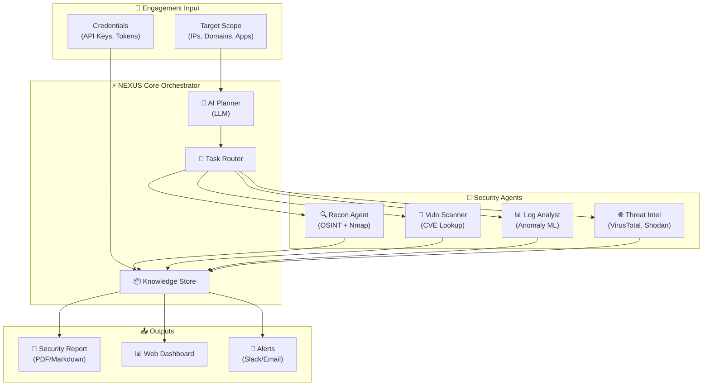

<div align="center">

# 🛡️ NEXUS-STRIKE

**AI-Powered Autonomous Cybersecurity Platform**

[](https://github.com/harinish45/harrysecurity-agent/actions/workflows/ci.yml)
[](LICENSE)
[](https://python.org)
[](Dockerfile)
[](https://trivy.dev)

> *Autonomous security platform combining LLM intelligence with real-world penetration testing workflows*

[📋 TODO](TODO.md) · [🔒 Security Policy](SECURITY.md) · [🤝 Contributing](CONTRIBUTING.md)

</div>

---

## 🏗️ Platform Architecture



---

## 🚀 Quick Start

```bash
git clone https://github.com/harinish45/harrysecurity-agent.git
cd harrysecurity-agent

# With Docker (recommended)
docker compose up --build

# Local
pip install -r requirements.txt
make dev
```

---

## 📋 Feature Coverage

| Module | Status | Priority |
|--------|--------|----------|
| 🔍 OSINT / Recon Agent | 🔧 In Progress | HIGH |
| 🎯 Vulnerability Scanner | 🔧 In Progress | HIGH |
| 📊 Log Analysis (ML) | 📋 Planned | HIGH |
| 🌐 Threat Intelligence | 📋 Planned | MEDIUM |
| 📄 Report Generator | 📋 Planned | MEDIUM |
| 🌐 Web Dashboard | 🔧 In Progress | MEDIUM |
| 🔒 Compliance Mapping | 📋 Planned | LOW |

---

## 📁 Structure

```
harrysecurity-agent/
├── 🧠  nexus/           # Core agent orchestration
├── 🌐  web/             # FastAPI web UI
├── 📚  knowledge/       # Threat intelligence KB
├── 💬  prompts/         # LLM prompt library
├── 🎯  engagements/     # Security workflows
├── 🧪  tests/           # Test suite
├── 📊  benchmarks/      # Performance benchmarks
├── 🐳  Dockerfile       # Container
└── 📋  Makefile         # Build commands
```

---

<div align="center">
⚠️ For authorized security testing only · <a href="LICENSE">MIT License</a>
</div>